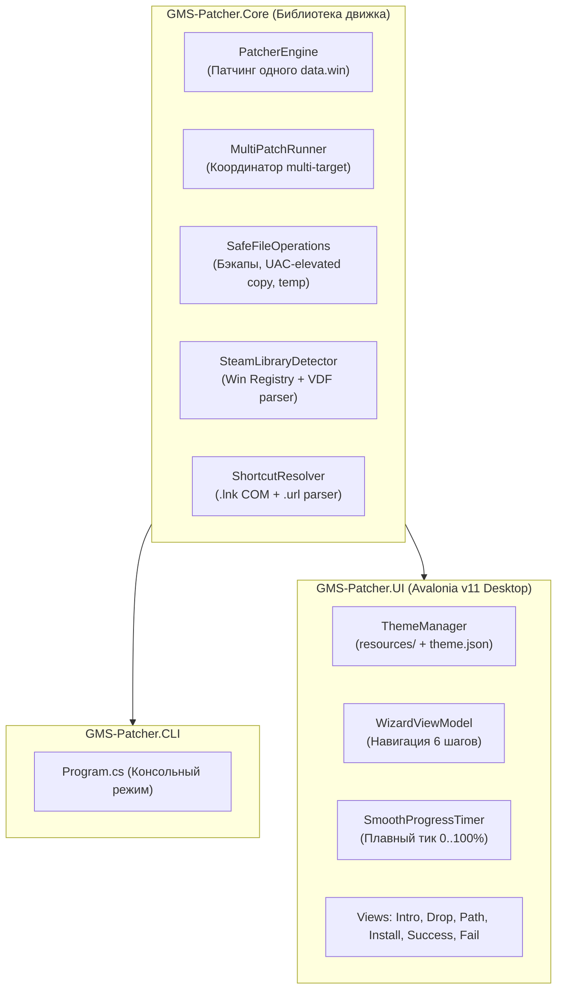

# План реализации обновления: GMS-UTML-Patcher v2.0 (GUI & Multi-Target)

## 1. Обзор и цели версии 2.0

Цель обновления — создать единый, автономный кроссплатформенный инструмент и визуальный установщик на **.NET 10** и **Avalonia UI 11**, полностью заменив громоздкую связку из Python, PySide6, `subprocess` и временных `.bat` скриптов.

### Ключевые требования:
1. **Кроссплатформенный GUI-установщик (Windows, macOS, Linux)**:
   - Работает нативно без внешних зависимостей (Python, Qt рантаймы не требуются).
   - Собирается в компактный единый исполняемый файл (`--self-contained -p:PublishSingleFile=true`).
   - Выполняет патчинг напрямую в том же процессе через API библиотеки ядра, сохраняя при этом отдельный CLI-режим.
2. **Multi-Target патчинг (для DELTARUNE и мульти-модульных игр)**:
   - Патчинг произвольного числа игровых файлов (`data.win`, `chapter1/data.win`, `chapter2/data.win` и т.д.) в рамках одной сессии.
   - Копирование сопутствующих папок и файлов (конфиги, скрипты, `ru_data.json`).
   - Автоматическое создание бэкапов (`data.orig.win`) без перезаписи существующих бэкапов.
3. **100% паритет UX/UI с PySide6-мастером (`gui-patcher-ref/`)**:
   - Мастер установки фиксированного размера (530 × 400).
   - 6 экранов: **Intro**, **Drop Zone**, **Select Path**, **Installation**, **End Success**, **End Fail**.
   - Анимированный маскот во время установки (`.gif`).
   - Плавная анимация прогресс-бара (`smooth tick`).
   - Сворачиваемая консоль логов с автопрокруткой.
4. **Динамическая кастомизация (`resources/`)**:
   - Возможность для сторонних разработчиков модов заменить визуал установщика (арты, иконки, маскот, ссылки на соцсети, заголовок и цвета) просто положив папку `resources/` рядом с бинарником.

---

## 2. Анализ реального опыта PySide6 и системные условности

На основе детального анализа исходников `gui-patcher-ref/` (`mainwindow.py`, `copy_files.py`, `messageboxes.py`) выявлен ряд критических системных нюансов, с которыми сталкивались пользователи. Все они должны быть решены на уровне архитектуры v2.0:

### 2.1. Windows: UIPI и запуск от имени Администратора
- **Проблема**: Если установщик запущен с повышенными привилегиями (UAC / Run as Administrator), механизм Windows **UIPI** (*User Interface Privilege Isolation*) блокирует оконные сообщения `WM_DROPFILES` и OLE Drag-and-Drop от проводника (`explorer.exe`), работающего без прав администратора. В результате пользователь пытается перетащить ярлык или папку, но курсор показывает знак запрета `🚫`.
- **Решение в v2.0**:
  - При запуске проверяем привилегии через `WindowsPrincipal.IsInRole(WindowsBuiltInRole.Administrator)`.
  - Если процесс запущен под админом:
    1. Показываем предупреждающее модальное окно (как в `messageboxes.py`): *«Программа запущена с правами администратора. Функция Drag-and-Drop может не работать. Используйте Классический режим выбора»*.
    2. В зоне `dropFrame` выводим подсказку с прямой кнопкой переключения на ручной выбор.

### 2.2. Разрешение ярлыков (`.lnk` и `.url` Steam)
Пользователи часто перетаскивают на окно не саму папку с игрой, а ярлык с рабочего стола:
- **Обычные ярлыки Windows (`.lnk`)**:
  - В v2.0 реализуем нативное извлечение целевого пути ярлыка через COM-интерфейс `IShellLinkW` / `IPersistFile` (без необходимости внешних утилит).
  - Если целевой файл — `.exe`, берется родительская папка.
- **Ярлыки Steam (`.url`)**:
  - Ярлыки Steam содержат URL вида `steam://rungameid/1672970`.
  - При обнаружении такого файла запускается автоматический сканер библиотек Steam.

### 2.3. Автоматический поиск игры в библиотеках Steam
- **Windows**:
  - Чтение пути Steam из реестра: `HKCU\Software\Valve\Steam\SteamPath`.
  - Парсинг файла `steamapps/libraryfolders.vdf` для нахождения всех подключенных дисков (например, `D:\SteamLibrary`, `E:\Games\Steam`).
  - Проверка наличия папки игры во всех библиотеках.
- **macOS**:
  - Проверка путей `~/Library/Application Support/Steam` и `/Applications/Steam.app/Contents/MacOS/steamapps`.
  - Парсинг `libraryfolders.vdf` и поиск `.app` бандла.

### 2.4. UAC и права на перезапись файлов в `Program Files (x86)`
- **Проблема**: Steam по умолчанию ставит игры в `C:\Program Files (x86)\Steam\...`. Обычный процесс без прав админа не может перезаписать `data.win` или скопировать файлы локализации.
- **Решение в v2.0**:
  - Патчинг создаёт новые файлы во временной папке (или папке патча).
  - Перед заменой проверяется доступ на запись в целевую директорию игры.
  - Если доступ есть — файлы заменяются напрямую в C#.
  - Если получен `UnauthorizedAccessException`: запускается встроенный механизм эскалации (аналог `copy_files.py`), выполняющий атомарную замену файлов через повышенный процесс `runas`, без необходимости запускать весь UI под админом с самого начала (что спасает работу Drag & Drop!).

### 2.5. macOS: DMG Translocation, карантин и пути к ресурсам
- **Проблема Translocation**: Если пользователь запустил приложение прямо из смонтированного DMG-образа или из временной папки карантина (`/Volumes/...` или `/private/var/folders/...`), приложение работает в изолированном read-only окружении.
- **Решение**: Проверка `AppPath`: если путь начинается с `/Volumes/` или `/private/`, выводим диалог: *«Скопируйте установщик в папку "Программы" или на рабочий стол перед запуском»* и завершаем работу.
- **Структура .app на macOS**:
  - Игровые файлы лежат в `DELTARUNE.app/Contents/Resources`.
  - Детектор пути автоматически нормализует путь, если пользователь бросил сам `.app`, его родительскую папку или файл внутри `Contents/Resources`.
  - Снятие карантина (`xattr -d com.apple.quarantine`) и установка прав на запуск (`chmod +x`).

### 2.6. Интерактивные предупреждения версий и хэшей (Коды 204, 205, 206)
- При проверке оригинального `data.win` патчер может выдать:
  - `204`: Не совпал MD5 хэш (файл уже модифицирован другим патчем или отличается).
  - `205`: Не совпал таймстемп компиляции GameMaker.
  - `206`: Не совпала версия GameMaker.
- **Поведение в v2.0**:
  - Вместо аварийного падения движок приостанавливается и запрашивает подтверждение у пользователя через красивое диалоговое окно (`mnogo_voprosoff_warning.png`):
    - *«Версия игры и перевода не совпадает! Продолжить установку на свой страх и риск?»*
    - *«Обнаружена модификация! Возможно перевод уже установлен. Переустановить?»*
  - Если пользователь нажимает **«Продолжить»** — патчер автоматически повторяет шаг с флагами `--skip-timecheck` / `--skip-hashcheck`.
  - Если нажимает **«Отменить»** — установка плавно переходит на экран неудачи с объяснением.

---

## 3. Архитектура решения



### Структура проектов в репозитории:
1. **`GMS-Patcher/` (Core Library & CLI)**:
   - Содержит все алгоритмы распаковки, модификации и упаковки UndertaleData (код, текстуры, комнаты, объекты, шейдеры, настройки).
   - `PatcherEngine.cs` — единая точка входа для патчинга одного `data.win`.
   - `MultiPatchRunner.cs` — координатор пакетного патчинга и копирования файлов.
   - `Program.cs` — CLI интерфейс для консольного запуска.
2. **`GMS-Patcher.UI/` (Avalonia 11 GUI)**:
   - Кроссплатформенный GUI-проект (Target: `net10.0`).
   - Использует `FluentTheme` со стилизацией под референс `form.ui`.
   - Поддерживает SingleFile self-contained сборку для Windows, macOS, Linux.

---

## 4. Спецификация конфигурации Multi-Target (`patch_suite.json`)

Для поддержки проектов уровня DELTARUNE конфигурация патча описывает не только один файл, но и всю структуру игры:

```json
{
  "name": "DELTARUNE: Ручной перевод (Главы 1-2)",
  "gameId": "deltarune",
  "version": "1.2.0",
  "requiredSpaceMB": 900,
  "detection": {
    "windowsExe": "DELTARUNE.exe",
    "macApp": "DELTARUNE.app",
    "steamAppId": "1672970"
  },
  "targets": [
    {
      "id": "selector",
      "title": "Селектор глав",
      "relativePath": "data.win",
      "macRelativePath": "game.ios",
      "patchDir": "patches/ch_sel",
      "patchConfig": "patches/ch_sel/data.win.json",
      "backupFile": "data.orig.win",
      "macBackupFile": "game.orig.ios",
      "required": true
    },
    {
      "id": "ch1",
      "title": "Глава 1",
      "relativePath": "chapter1_windows/data.win",
      "macRelativePath": "chapter1_mac/game.ios",
      "patchDir": "patches/ch1",
      "patchConfig": "patches/ch1/data.win.json",
      "backupFile": "chapter1_windows/data.orig.win",
      "macBackupFile": "chapter1_mac/game.orig.ios",
      "required": true
    },
    {
      "id": "ch2",
      "title": "Глава 2",
      "relativePath": "chapter2_windows/data.win",
      "macRelativePath": "chapter2_mac/game.ios",
      "patchDir": "patches/ch2",
      "patchConfig": "patches/ch2/data.win.json",
      "backupFile": "chapter2_windows/data.orig.win",
      "macBackupFile": "chapter2_mac/game.orig.ios",
      "required": true
    }
  ],
  "copyOperations": {
    "folders": [
      { "source": "patches/copy/chapter1", "dest": "chapter1_windows", "macDest": "chapter1_mac" }
    ],
    "files": [
      { "source": "patches/copy/ru_data.json", "dest": "ru_data.json" }
    ]
  }
}
```

> [!NOTE]
> Сохраняется полная обратная совместимость: если передан путь к одиночному `patch.json`, установщик работает в режиме одиночного файла.

---

## 5. Визуальный дизайн и логика страниц мастера (Паритет с PySide6)

Разрешение окна: **530 × 400** (фиксированное, центрированное при запуске).

### 1. Intro Page (`intro`):
- **Слева**: Баннер 171 × 351 (`preview.png`).
- **Справа**: Заголовок мода, подзаголовок, номер версии, кликабельная ссылка на отчёт об ошибках (`issues`).
- **Внизу**: Кнопка «Отмена» (выход) и кнопка «Далее» (переход на `drop_link`).

### 2. Drag & Drop Page (`drop_link`):
- **Сверху**: Шапка с иконкой (`icon.png`), заголовком и подзаголовком.
- **Центр**: Фрейм `dropFrame` со скруглённой рамкой:
  - *Дефолтное состояние*: иконка `drop_icon.png` + текст *«Перетащите иконку игры, чтобы указать путь к папке»*.
  - *Наведение (DragEnter)*: фон подсвечивается серым/акцентным оттенком.
  - *Успешное нахождение игры*: иконка `drop_icon_game.png`, отображение найденного пути и кнопка «Далее» становится активной.
  - *Ошибка / не найдено*: иконка `drop_icon_err.png`, текст ошибки.
- **Индикаторы места**: «Требуется места: X Мбайт» и «Доступно места: Y Мбайт» (с динамическим пересчётом свободного места на выбранном томе).
- **Ссылка**: «Не работает? Классический режим» (переход на `select_path`).

### 3. Select Path Page (`select_path`):
- Классический файловый диалог (`OpenFolderDialog` / `OpenFileDialog`).
- Поле ввода пути (`pathField`) с валидацией «на лету» при вводе текста.
- Ссылка «Вернуться к Drag & Drop».

### 4. Installation Page (`installation`):
- **Маскот**: Воспроизведение анимации (`lytaya_animka_ralsei2009.gif` / кадры спрайта).
- **Прогресс**: Плавный прогресс-бар (`SmoothProgressTimer`, шаг 1-2%, интервал 5-10мс) и процентный текст (0-100%).
- **Статус**: Название текущего этапа (например, *«Патчим Главу 1: Импорт текстур...»*).
- **Консоль логов**: Кнопка «Подробнее» разворачивает текстовое поле `detailedlogs` с полным выводом логов и автоскроллом вниз.
- **В случае ошибки**: Маскот меняется на поверженного персонажа (`ralsei_down.png`), лог автоматически раскрывается, кнопка переходит на `end_fail`.

### 5. Success Page (`end_success`):
- **Слева**: Арт победы (`queen_sprite.png`).
- **Справа**: Заголовок «Установка успешно завершена!», описание.
- **Ссылка на сообщество**: Telegram / Discord / VK.
- **Чекбокс**: «Запустить DELTARUNE» (запускает `.exe` или `open -a` при закрытии).
- **Кнопка**: «Завершить».

### 6. Failure Page (`end_fail`):
- **Слева**: Арт ошибки (`queen_sprite_error.png`).
- **Справа**: Заголовок «Ошибка при установке», текстовое поле с кодом ошибки и описанием.
- **Ссылка**: «Сообщить об ошибке на GitHub».
- **Кнопка**: «Выход».

---

## 6. Система динамической кастомизации (`resources/`)

Для адаптации установщика под любой мод не требуется трогать исходный код C#:

```
MyGame-Patcher/
├── GMS-Patcher-UI.exe (или исполняемый файл для macOS/Linux)
├── patch_suite.json
├── patches/
└── resources/                      <-- Переопределение визуального стиля
    ├── theme.json                  <-- Тексты, ссылки, цвета
    ├── icon.png                    <-- Иконка шапки и окна
    ├── cozyinn.ico                 <-- Windows иконка
    ├── preview.png                 <-- Баннер на Intro
    ├── drop_icon.png               <-- Иконка зоны перетаскивания
    ├── drop_icon_game.png          <-- Иконка найденной игры
    ├── drop_icon_err.png           <-- Иконка ошибки в зоне
    ├── mascot.gif                  <-- Анимация процесса установки
    ├── ralsei_down.png             <-- Изображение при ошибке установки
    ├── queen_sprite.png            <-- Арт успешной установки
    ├── queen_sprite_error.png      <-- Арт экрана ошибки
    └── warning.png                 <-- Иконка предупреждений
```

### Конфигурация `resources/theme.json`:
```json
{
  "windowTitle": "DELTARUNE — Установщик перевода",
  "accentColor": "#6C5CE7",
  "links": {
    "issues": "https://github.com/myteam/deltarune-ru/issues",
    "community": "https://t.me/deltarune_ru",
    "communityText": "Наш Telegram-канал"
  },
  "texts": {
    "introTitle": "Мастер установки перевода DELTARUNE",
    "introSubtitle": "Программа установит русификатор для Главы 1 и Главы 2.",
    "version": "v1.2.0",
    "successTitle": "Перевод успешно установлен!",
    "successSubtitle": "Патч успешно применён к файлам игры.",
    "launchCheckbox": "Запустить DELTARUNE"
  }
}
```

> Если внешний файл или папка `resources/` отсутствует, установщик автоматически загружает встроенные ресурсы по умолчанию (`gui-patcher-ref/resources`).

---

## 7. Пошаговый план разработки (Roadmap)

### Этап 1: Рефакторинг ядра и системные сервисы (Core)
- [ ] **1.1. Выделение `PatcherEngine`**: вынос логики патчинга из `Program.cs` в библиотечный класс с поддержкой `IProgress<PatchProgress>` и интерфейса логирования `IPatchLogger`.
- [ ] **1.2. Системные сервисы**:
  - `ShortcutResolver`: нативное чтение путей `.lnk` (через Win32 COM `IShellLinkW`) и парсинг Steam `.url`.
  - `SteamLibraryDetector`: чтение реестра Windows и парсинг `libraryfolders.vdf` для нахождения библиотек Steam на всех дисках (Windows + macOS).
  - `AdminPrivilegeHelper`: детекция запуска под администратором (предотвращение проблем с UIPI/Drag-and-Drop).
  - `MacSecurityHelper`: проверка запуска из DMG/Translocation, снятие карантина `com.apple.quarantine`.
- [ ] **1.3. Multi-Target Runner**:
  - Чтение и валидация `patch_suite.json`.
  - Последовательное выполнение патчинга для списка целей с трансляцией общего прогресса.
  - Безопасное резервное копирование (`.orig.win`) и механизм отката при ошибке.
  - Копирование сопутствующих директорий и файлов с возможностью повышения прав при `UnauthorizedAccessException`.

### Этап 2: Создание проекта `GMS-Patcher.UI` на Avalonia 11
- [ ] **2.1. Инициализация проекта**:
  - Создание проекта `GMS-Patcher.UI.csproj` на базе Avalonia 11 (.NET 8).
  - Подключение ссылки на `GMS-Patcher.csproj`.
  - Настройка стилей, цветов и геометрии окна (530 × 400, фиксированный размер, центрирование).
- [ ] **2.2. ThemeManager & Resource Loader**:
  - Встраивание ресурсов из `gui-patcher-ref/resources/` как fallback `EmbeddedResource`.
  - Загрузчик внешних ресурсов из папки `./resources/` (изображения, `.ico`, `theme.json`).
- [ ] **2.3. Каркас мастера (Wizard Navigation)**:
  - Реализация `WizardViewModel` с состояниями страниц: `Intro`, `DropLink`, `SelectPath`, `Installation`, `EndSuccess`, `EndFail`.
  - Логика блокировки и валидации переходов («Далее» / «Назад» / «Отмена»).

### Этап 3: Вёрстка страниц мастера
- [ ] **3.1. Страница Intro**: левый баннер, заголовок, версия, ссылка на Issues.
- [ ] **3.2. Страница Drag & Drop**:
  - Зона `dropFrame` со стилизацией рамки и сменой фона при наведении.
  - Обработчики `DragOver`, `DragLeave`, `Drop`.
  - Автодетекция при броске папки, `.exe`, `.app`, `.lnk`, `.url`.
  - Проверка прав администратора и предупреждение о Drag & Drop (UIPI).
  - Расчёт свободного места на выбранном диске.
- [ ] **3.3. Страница Select Path**:
  - Текстовое поле с путём к игре и кнопка «Обзор...» (нативный диалог выбора папки).
  - Валидация наличия всех файлов игры на лету.
- [ ] **3.4. Страница Installation**:
  - Воспроизведение анимированного маскота (`.gif`).
  - Прогресс-бар с плавной интерполяцией процентов (`SmoothProgressTimer`).
  - Кнопка «Подробнее» со сворачиваемой консолью подробных логов и автоскроллом.
- [ ] **3.5. Страницы результата (Success & Fail)**:
  - Отображение артов победы и ошибки.
  - Кнопка/чекбокс запуска игры (`Process.Start` на Windows, `open -a` на macOS).
  - Ссылки на Telegram/Discord и баг-трекер.

### Этап 4: Интерактивные диалоги и связывание потоков
- [ ] **4.1. Диалоги предупреждений версий (коды 204, 205, 206)**:
  - Модальное окно при несовпадении версий или хэшей с выбором «Продолжить» / «Отменить».
  - Повторный запуск шага с флагами `--skip-timecheck` / `--skip-hashcheck` при согласии пользователя.
- [ ] **4.2. Фоновое выполнение**:
  - Запуск `MultiPatchRunner` в фоновом потоке (`Task.Run`) без блокировки UI.
  - Корректная обработка исключений и переход на `EndFail` с записью ошибки в лог.

### Этап 5: Сборка, упаковка и тестирование (`build.ps1`)
- [ ] **5.1. Обновление скрипта `build.ps1`**:
  - Сборка `GMS-Patcher.UI` под `win-x64`, `osx-x64`, `osx-arm64`, `linux-x64`.
  - Генерация zip-архивов дистрибутива.
- [ ] **5.2. Тестирование**:
  - Проверка работы Drag & Drop на Windows (в обычном режиме и предупреждения под админом).
  - Проверка автопоиска Steam.
  - Проверка кастомизации через папку `resources/`.

